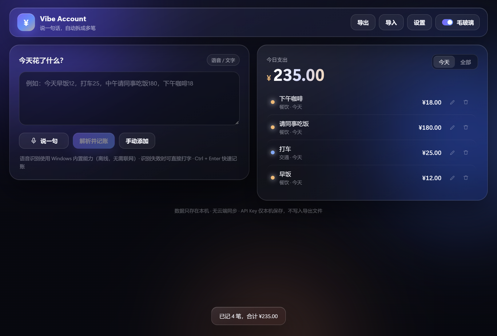

# Vibe Account

> 说一句话，自动拆成多笔支出。本地优先的 Windows 语音记账 MVP（Tauri 2 + React + TypeScript）。



## 功能

- **语音记账**：点「说一句」用内置的本地 Whisper（whisper.cpp + 内置模型）完全离线识别，装好就能用，不用联网、也不用装 Windows 语音包；模型缺失时自动回退 Windows 识别，仍不可用可直接打字。
- **一句话拆多笔**：调用你配置的 OpenAI 兼容大模型，把「早饭12，打车25，中午请同事吃饭180」拆成 4 条记录。
- **手动兜底**：手动添加、编辑、删除；金额精确到分，日期可选。
- **今日合计**：今天 / 全部两个视图，自动汇总。
- **本地持久化**：数据存 JSON，重启不丢；支持整体导出 / 导入（合并去重）。
- **毛玻璃 UI**：半透明、模糊、柔和渐变、光影层次；在「设置 → 毛玻璃」开关可关闭（关闭后改为实色卡片，低配设备更流畅），选择会记住。
- **错误兜底**：未配置 Key、麦克风失败、语音识别失败、模型返回异常、保存失败都有中文提示。

## 安装与运行

**安装版**：双击 `Vibe Account_0.1.0_x64-setup.exe`，按向导安装（当前用户，不需要管理员）。开始菜单会出现「Vibe Account」。

**免安装版**：把 `Vibe Account-portable.exe`、`WebView2Loader.dll` 和 `whisper\` 文件夹（含 `whisper-cli.exe` 与 `models\ggml-base-q5_1.bin`，约 60 MB）放在**同一个文件夹**里，双击 exe 运行。数据默认在 `%APPDATA%\com.vibeaccount.app\`；若该目录不可写，会自动放到 exe 同级的 `data\` 文件夹。

系统要求：Windows 10/11 x64，WebView2 运行时（Win11 自带；Win10 若缺失，安装包会自动装）。

## 首次配置（必须）

1. 打开右上角 **设置**。
2. 填 **Base URL**、**模型**、**API Key**，保存。常见写法：

   | 服务 | Base URL | 模型示例 |
   | --- | --- | --- |
   | DeepSeek | `https://api.deepseek.com/v1` | `deepseek-chat` |
   | 通义千问（兼容模式） | `https://dashscope.aliyuncs.com/compatible-mode/v1` | `qwen-plus` |
   | 智谱 | `https://open.bigmodel.cn/api/paas/v4` | `glm-4-flash` |
   | 本地 Ollama | `http://127.0.0.1:11434/v1` | `qwen2.5:7b` |

   Base URL 只填到 `/v1` 即可，程序会自动补 `/chat/completions`。

3. 回到首页，输入或说出一段消费描述，点「解析并记账」。

## 使用

- 语音：点「说一句」开始，按钮变成「点一下停止」——再点一下立即结束录音并转文字（不等 15 秒上限）；文字进入输入框，确认后解析。模型随安装包提供，不需要下载。
- 键盘：`Ctrl + Enter` 直接解析。
- 编辑 / 删除：每条记录右侧的铅笔 / 垃圾桶图标。
- 导出：右上角「导出」下载 `vibe-account-YYYY-MM-DD.json`（只含账目，不含 Key）。
- 导入：右上角「导入」选择之前导出的 JSON；按 id 去重，不会重复记账。

## 数据与隐私

| 内容 | 位置 |
| --- | --- |
| 账目 `data.json` | `%APPDATA%\com.vibeaccount.app\` |
| 配置 `config.json` | 同上 |
| API Key `credentials.txt` | 同上（明文，仅当前 Windows 用户可读） |
| 语音模型 `models\ggml-base-q5_1.bin` | 安装目录 `whisper\models\`（随包提供，约 57 MB）；仅精简构建缺失时才会下载到数据目录 |
| WebView2 缓存 | `%LOCALAPPDATA%\com.vibeaccount.app\` |

- 只有「解析并记账」会把文字发给你配置的模型服务；语音识别在本机完成，模型随包提供，识别过程不联网。
- Key 不写日志、不导出、不随 JSON 泄露；但它是**明文文件**，请勿把数据目录发给别人。
- 没有账号、没有云同步、没有遥测。
- 便携版可用环境变量覆盖位置：`VIBE_DATA_DIR`、`VIBE_WEBVIEW_DIR`。

## 开发

```powershell
npm install
npm run tauri dev      # 开发模式（需要 Rust + MinGW/MSVC）
npm run tauri build    # 生产构建，产物在 src-tauri/target/release/
```

- 前端：`src/`（React 18 + Vite）
- 后端：`src-tauri/src/`
  - `storage.rs` 数据读写（tmp + rename 原子写）
  - `llm.rs` 模型调用与 JSON 校验（元 → 分、金额上限、类别白名单）
  - `speech.rs` Windows 语音识别（兜底）
  - `whisper.rs` 本地 whisper.cpp：模型下载、cpal 录音、转写
- 本机构建备注：MinGW-w64 + `x86_64-pc-windows-gnu`；若 cargo 报临时文件权限问题，把 `TEMP` 指到工作区目录。
- 语音资源：`src-tauri/whisper/whisper-cli.exe`（静态链接）与 `src-tauri/whisper/models/ggml-base-q5_1.bin`；打包时由 `tauri.conf.json` 的 `resources` 一起带进安装包。

## 语音识别：本地优先

默认使用内置 whisper.cpp（`whisper\whisper-cli.exe`）+ 内置的 `ggml-base-q5_1` 模型，完全离线，不需要安装 Windows 语音包，也不需要首次下载。

- 启动后右下角直接显示「本地语音已就绪（离线识别，无需联网）」。
- 只有精简构建（去掉了模型）才会在启动时下载；下载失败时短暂回退 Windows 识别，若系统也没装中文语音包会提示 `0x800455A0`。此时打字始终可用。
- 想强制用 Windows 识别（例如公司策略），按系统提示安装组件即可：设置 → 时间和语言 → 语言和区域 → 中文(简体) → 语言选项 → 语音 → 安装「语音识别」；或用管理员 PowerShell：

```powershell
Get-WindowsCapability -Online | Where-Object Name -like "*Speech*"
Add-WindowsCapability -Online -Name "Language.Speech~~~zh-CN~0.0.1.0"
```

之后在 设置 → 隐私和安全性 → 语音 里打开「在线语音识别」。

## 已知限制

- 安装包因为内置了语音模型，体积约 60 MB；免安装版必须连 `whisper\models\` 一起拷贝。
- 本地识别用 base 模型，安静环境、普通话说清楚时效果最好；嘈杂环境可能识别不准，可改打字。
- 解析质量取决于你选的模型；换模型或网络异常时会有提示，不会静默写错。
- 只做支出，不做收入/转账/退款/多币种（MVP 范围）。
- 安装包与 exe 已用自签名证书签名（`VibeAccount-CodeSigning.cer`）；因为根证书不在别人的「受信任的根证书颁发机构」里，别人机器首次运行仍会看到「未知发布者 / SmartScreen」提示，属正常现象，见下节。

## 签名与信任

本仓库的 `release/` 里附带了签名证书 `VibeAccount-CodeSigning.cer`（自签名，CN=Vibe Account，有效期 3 年）。

- **自己这台机器想消掉警告**：双击 `.cer` → 安装证书 → 本地计算机 → 受信任的根证书颁发机构；再把证书装进「受信任的发布者」。之后 `Get-AuthenticodeSignature` 会显示 Valid。
- **别人机器**：除非他们也安装这个 `.cer`，否则仍会提示未知发布者；自签名无法绕过这一点。
- **想做到所有人免警告**：需要购买受信任的代码签名证书（DigiCert / Sectigo / Certum 等，通常需要个人或企业实名认证）；开源项目也可以申请 SignPath.io 或 Certum 的免费开源签名，审核通过后用它重签即可，命令不变：

```powershell
Set-AuthenticodeSignature -FilePath "Vibe Account-portable.exe" `
  -Certificate (Get-ChildItem Cert:\CurrentUser\My\<thumbprint>) `
  -TimestampServer "http://timestamp.digicert.com"
```

## 验收自检

| 要求 | 结果 |
| --- | --- |
| 能安装启动 | ✅ NSIS 安装包 + 免安装 exe |
| 一段话解析多笔并正确合计 | ✅ 4 笔 / ¥235.00（自动化验证） |
| 记录可编辑删除 | ✅ 18→20（合计 237）、删除后 217 |
| 重启后数据还在 | ✅ 重启后 3 条 / ¥217.00 |
| 毛玻璃可关闭 | ✅ 开关后 `backdrop-filter: none`，重启保持 |
| Key 不泄露 | ✅ 导出 JSON 不含 Key，日志不打印 |
